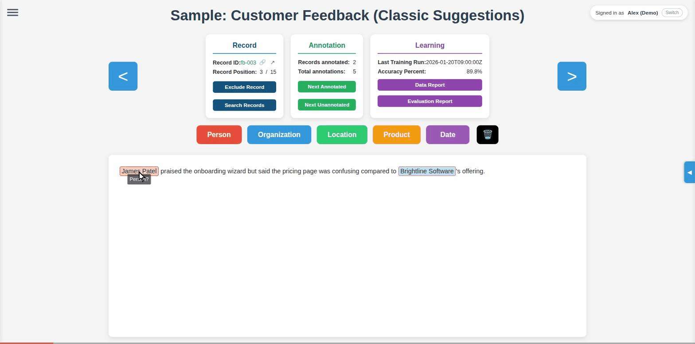
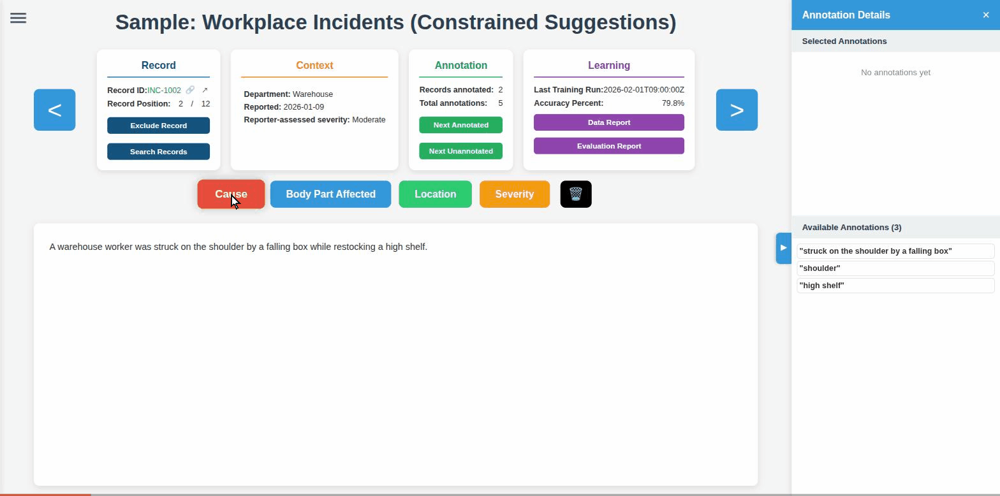

# SPANnotator

A self-hosted, web-based tool for annotating spans of text — the kind of workflow you'd use to
build a training set for a named-entity-recognition model, a text classifier, or any project that
needs humans to mark up spans of text with labels. It's built as an ASP.NET Core app that reads
and writes plain CSV/JSON files, so there's no database to set up and your data never leaves the
folder you point it at.

It was originally built for coding workplace-incident reports against a fixed taxonomy (TOOCS),
but the annotation model — arbitrary span labels over arbitrary text records — is general purpose.
The two sample projects bundled with this repo (see [Sample Projects](#sample-projects)) show two
quite different uses of it.

## Contents

- [What it does](#what-it-does)
- [Quick start](#quick-start)
- [Sample projects](#sample-projects)
- [Core concepts](#core-concepts)
- [Features](#features)
- [Authentication](#authentication)
- [Configuring a corpus](#configuring-a-corpus)
- [Data file formats](#data-file-formats)
- [API reference](#api-reference)
- [Deployment](#deployment)
- [Project layout](#project-layout)
- [Troubleshooting](#troubleshooting)
- [Security & data handling](#security--data-handling)
- [Potential future features](#potential-future-features)

## What it does

You give the tool a CSV of text records and a config describing what labels ("span types") you
want annotated. It renders each record as an editable page: annotators select text and tag it,
and every annotation is streamed straight to an output CSV as it happens — there's no "save"
button and nothing lives only in the browser. Optionally, you can also feed it AI-generated
suggestions to speed annotators up, either as fully-formed suggested annotations they can accept
with one click, or as suggested span *boundaries* they classify themselves.

The tool supports any number of these "corpora" (datasets/projects) side by side, switchable from
a menu, each with its own labels, data files, and behaviour — so one deployment can serve several
unrelated annotation projects at once.

**Classic suggestions** — select a span type, then drag to annotate; click a red-bordered
suggestion to accept it as-is:



**Constrained suggestions** — annotators pick from AI-proposed boundaries and assign the label
themselves, including overlapping/nested spans:



## Quick start

Requirements: [.NET 9.0 SDK](https://dotnet.microsoft.com/download).

```bash
git clone <this-repo>
cd SPANnotator
dotnet run
```

Not sure whether you have a matching .NET SDK installed, or where it landed on disk? Run
`./run.sh` instead — it looks for `dotnet` in the usual install locations (apt/distro package,
`~/.dotnet`, snap, etc.), prints a clear error with install instructions if it can't find one, then
restores and runs. It reads the required SDK version from `global.json`, so it stays correct if
that file is ever updated.

The console will print the URL to open — by default `http://localhost:5139` (or
`https://localhost:7035`; see `Properties/launchSettings.json` if you've changed it). The app
loads with the bundled **Sample - Customer Feedback** corpus already configured, so you can start
annotating immediately with no setup.

Open the hamburger menu (☰) in the top-left to switch to the other sample corpus, **Sample -
Workplace Incidents**, which shows off the more advanced configuration options.

> The bundled `config.json` uses the lightweight "simple" sign-in mode (see
> [Authentication](#authentication)), so the first time you open the app you'll be asked to pick a
> name from `users.json` and set a PIN. This works out of the box on any OS — no Windows domain or
> IIS required. It's demo config; swap in your own `users.json` (or switch to Windows
> Authentication) before a real deployment.

## Sample projects

Two ready-to-run corpora ship in `wwwroot/data/`, configured in `wwwroot/config.json`. Between
them they exercise every configuration option the tool supports — use them as a reference when
building your own corpus, or just delete them once you have real data configured.

### Sample - Customer Feedback

The "plain" configuration: 15 short customer-feedback snippets, five span types (`Person`,
`Organization`, `Location`, `Product`, `Date`), and the **classic suggestion workflow** —
AI-proposed annotations already carry a label and show up with a red border and a "?" suffix
(e.g. "Person?"); click one to accept it as-is. Two records already have human annotations so you
can try **Next Annotated**/**Next Unannotated** navigation right away, and four more have pending
suggestions to accept.

### Sample - Workplace Incidents

The "everything on" configuration: 12 short incident descriptions, four span types (`Cause`,
`Body Part Affected`, `Location`, `Severity`), and the **constrained suggestion workflow**
(`suggestionsConfineAnnotations: true`) — suggestions here carry no label, only a boundary, so
annotators pick from a dropdown of AI-proposed spans and assign the label themselves; free-text
selection is disabled. This corpus also demonstrates:

- **A context panel** (`recordContextTemplate`) showing each record's Department, reported date,
  and reporter-assessed severity — fields that exist in `input.csv` but aren't part of the
  annotatable text.
- **An external-system link** (`externalLinkURL`) — the ↗ icon next to the Record ID opens a
  (placeholder) URL built from the record's ID.
- **Non-default column names** — the ID and text columns are called `IncidentID` and
  `Description` rather than `id`/`text`, showing that these are configurable per corpus.

Both corpora also populate the **Learning Analytics** tile (`resultsJsonFile`) with example
accuracy figures and clickable Data/Evaluation reports, so you can see how that feature renders
even though the tool itself doesn't generate those reports — you plug in your own.

## Core concepts

- **Corpus** — one annotation project: an input CSV, an output CSV, optional suggestions, and a
  set of span types and settings. `wwwroot/config.json` can define any number of these.
- **Record** — one row of the input CSV, identified by `idColumnName`. Annotators move between
  records with the arrow buttons/keys, search, or the Next Annotated/Unannotated shortcuts.
- **Span / annotation** — a labelled substring of a record's text, defined by a `start`/`end`
  character offset into the raw text and a span type (one of `spanNames`). Overlapping and nested
  spans are supported.
- **Suggestion** — a candidate annotation from an external process (a model, a heuristic, a
  previous annotation pass). Suggestions live in a separate CSV from confirmed annotations and are
  never written to the output file until an annotator accepts them.
- **Exclusion** — a record can be marked out-of-scope instead of annotated. This is stored as a
  normal annotation row with `span=IGNORE` and `text=<reason>`, which also deletes any existing
  annotations on that record.

## Features

### Annotation

- Click a span-type button (or press `1`–`9`), then select text to create an annotation. Click
  the same button again to deselect and return to view-only mode.
- Overlapping and nested annotations are fully supported.
- Delete mode (🗑️) lets you remove annotations by selecting text that overlaps them.
- The **Annotation Details Panel** (toggle with the ◀ button on the right) lists every annotation
  at the current cursor position and every available suggestion for the record, so you can
  add/remove annotations without hunting through inline highlights.

### Annotation visual key

Every highlight in the text pane means one specific thing:

| Appearance | Meaning |
| --- | --- |
| Solid color highlight, span name in the hover tooltip | A **confirmed annotation** — saved to the output CSV. Each span type in a corpus gets its own color, auto-assigned from a fixed palette in the order `spanNames` is listed in `config.json` and consistent for the life of that corpus. |
| Colored highlight with a **red border** and a "SpanName**?**" label | An unaccepted **AI suggestion** (classic workflow) — click it to accept as-is. Turns into a normal confirmed annotation once accepted. |
| **Bright yellow** highlight with an **orange border** | An **out-of-alignment** annotation — its stored `start`/`end` offsets no longer match the current record text (constrained workflow only), so what's highlighted isn't what the annotation claims. Needs to be deleted and redone. |
| Brief **blue flash** (or your currently-selected span's color) on hover | A **suggestion preview** (constrained workflow) — shown while hovering a suggested boundary in the dropdown/details panel, before you click to accept it. Purely transient, not saved. |
| **Strikethrough**, dimmed text over the whole record | The **record is excluded** from annotation (`span=IGNORE`), not a span-level state — see [Exclusion](#core-concepts) and **Exclude Record** below. |

### AI suggestions

- **Classic workflow** (suggestions include a span name): shown inline with a red border and a
  "?" suffix; click to accept.
- **Constrained workflow** (suggestions omit the span name, and the corpus sets
  `suggestionsConfineAnnotations: true`): select a span-type button, click anywhere in the text,
  and a dropdown lists every suggested span overlapping that point. Hover to preview in your
  selected color; click to apply. Free-text selection is disabled in this mode, and any existing
  annotation that doesn't line up with a suggested boundary is highlighted bright yellow so it can
  be corrected.
- The two workflows can be mixed in a single suggestions file — rows with a span name render as
  classic suggestions, rows without render only in the constrained dropdown.
- Suggestions are only shown for records with no existing human annotations.
- A suggestions CSV can carry extra columns (a model's confidence score, feature values, etc.)
  beyond the required ones — the tool ignores anything it doesn't recognise, so you can pass
  scoring metadata through for your own reference without breaking the format.

### Navigation & search

- Arrow buttons/keys move between records; **Next Annotated** / **Next Unannotated** jump to the
  next record in that state.
- **Search Records** finds records by ID, position (1-based index into the corpus), or a
  substring of the record text, with a results preview showing each match's annotation status.
- The 🔗 icon next to the Record ID copies a deep link to that exact record+corpus
  (`?corpus=...&recordId=...` in the URL) — open it later to land straight back on that record.
- The ↗ icon (when `externalLinkURL` is configured) opens the record in an external system.

### Record management

- **Exclude Record** marks a record out of scope with a reason chosen from a configurable
  dropdown (`excludeReasons`); this deletes any existing annotations on the record and requires
  confirmation. **Include Record** reverses it.
- Record IDs are color-coded: 🟢 green (annotatable), 🔴 red (locked by another user), 🟠 orange
  (excluded).

### Multi-user collaboration & locking

- Every save/delete is tagged with the acting user's username (see
  [How usernames are determined](#how-usernames-are-determined)) and a client-side local
  timestamp.
- Starting to annotate a record acquires a **10-minute lock** on it (`POST
  /api/record-lock/acquire`), refreshed while you're active and released when you move on or close
  the tab. Another user can't save annotations to a locked record; expired locks are cleaned up
  automatically. Locks are stored per corpus in `wwwroot/data/locks/<corpus>_locks.json` and are
  local, ephemeral state — see [Security & data handling](#security--data-handling) for why
  they're excluded from git.
- All CSV writes go through an in-process per-file semaphore, so concurrent saves from different
  users never interleave or corrupt the output file.

### Multi-corpus support

- Any number of corpora can be defined in `wwwroot/config.json`, each with its own files, span
  types, and settings. Switch between them from the side panel (☰).

### Learning analytics

- If `resultsJsonFile` is configured, the "Learning Analytics" tile shows the last training run's
  timestamp and accuracy, plus buttons that open a **Data Report** and **Evaluation Report** —
  arbitrary static HTML files you generate however fits your pipeline (a notebook export, a script
  run after each training pass, etc.). See [results.json](#resultsjson-optional) for the schema.

### Performance

- A loading overlay with a staged progress bar (0–100%) covers configuration, input data,
  annotations, suggestions, analytics, and lock loading — useful feedback for CSV files well over
  100 MB.
- Corpus switching shows the same loading feedback.
- Static assets are served with cache-busting headers on `.css`/`.js`/`.csv`/`.json` so annotators
  always see the latest data and code without a hard refresh.

### How usernames are determined

The server, not the browser, decides who you are — a client can't spoof another user's name by
editing a request. Exactly how it resolves your identity depends on `globalSettings.authMode`; see
[Authentication](#authentication) for the three modes and their tradeoffs.

## Authentication

The tool has three interchangeable ways to attribute annotations to a person, selected once for
the whole deployment via `globalSettings.authMode` in `wwwroot/config.json`:

| `authMode` | Who annotators are | Setup required | Works without Windows |
|---|---|---|---|
| `"windows"` | The signed-in Windows identity (via Negotiate/Kerberos) | IIS + a Windows domain | No |
| `"simple"` | Whoever picked their name (+ optional PIN) from `users.json` | Edit one JSON file | **Yes** |
| `"none"` (or omitted) | The OS account the server process runs as — the same for everyone | None | Yes |

None of this is designed to withstand a hostile user — see the caveats under
[Security & data handling](#security--data-handling). It exists to answer "who annotated this
record", not to gate access to the tool.

### `"windows"` — Windows Authentication

Delegates identity entirely to IIS/Kerberos. See [Deployment](#deployment) for the IIS-side setup
this requires; there's no app-level configuration beyond setting `authMode: "windows"` (the legacy
`useWindowsAuthentication: true` flag still works too — see below).

### `"simple"` — username + PIN, no domain required

Designed for exactly the case Windows Authentication can't cover: a non-Windows deployment, or
just running the tool locally on a laptop, where you still want annotations attributed to the
right person without standing up any real infrastructure. It's a **low-friction, low-security**
mechanism — a name picker plus an optional short PIN, backed by a plain JSON file — appropriate for
a trusted internal tool, not something exposed to the public internet.

**`users.json`** (repository root, *not* under `wwwroot/` — it's never served as a static file)
lists who can sign in:

```json
{
  "users": [
    { "username": "jsmith", "displayName": "Jane Smith" },
    { "username": "achen", "displayName": "Alex Chen" }
  ]
}
```

`username` is the internal identifier written into output CSVs; `displayName` is what shows up in
the picker. That's the whole file to begin with — no passwords or PINs are stored until someone
actually signs in.

**How PINs work:** whether a PIN is required at all is one setting for the whole deployment,
`globalSettings.requirePin` (`true`/`false`) — not per user. When it's `true`:

- The **first time** a name is picked, whatever PIN the person types becomes that person's PIN
  from then on (hashed with a per-user salt via PBKDF2 and written back into `users.json` — the
  raw PIN is never stored). There's no separate admin step to provision PINs; this is what keeps
  it low-friction.
- Every time after that, the same PIN must be entered to sign in as that name.
- Forgot a PIN? Delete that user's `pinHash`/`pinSalt` fields from `users.json` (or the whole
  user entry and re-add it) and the next sign-in sets a fresh one.

When `requirePin` is `false`, picking a name signs you in immediately — pure attribution, zero
secrets, for contexts where even a PIN is more friction than it's worth.

Once signed in, the browser gets a long-lived (1 year) cookie, so this whole flow happens **once
per browser/device**, not once per session — after that it's exactly as invisible as Windows
Authentication. A small badge in the top-right shows who you're signed in as, with a **Switch**
link for shared machines.

### `"none"` — no authentication

Falls back to `Environment.UserName` — the OS account the server process itself runs as, the same
for every request. Fine for solo local use (it's effectively what the bundled samples used before
`"simple"` mode existed); with more than one concurrent annotator, everyone's work lands under one
name, so it's not a real multi-user mode.

### Backward compatibility

Configs written before `authMode` existed keep working unmodified: a top-level or
`globalSettings`-nested `useWindowsAuthentication: true` is treated as `authMode: "windows"`, and
`false` (or the field being absent) as `authMode: "none"`. New configs should prefer `authMode`
directly since it's the only way to reach `"simple"` mode.

Changing `authMode` requires an app restart — it's read once at startup to decide which
authentication middleware to wire up (the same constraint the old `useWindowsAuthentication` flag
always had).

## Configuring a corpus

Everything is driven by `wwwroot/config.json`. It has a `globalSettings` block plus a `corpora`
map, where each key is the corpus's internal name (used in URLs and lock filenames) and each
value is that corpus's configuration.

```json
{
  "globalSettings": {
    "authMode": "simple",
    "requirePin": true
  },
  "defaultCorpus": "My Corpus",
  "corpora": {
    "My Corpus": {
      "title": "My Corpus — Entity Annotation",
      "inputCsvFile": "data/My Corpus/input.csv",
      "outputCsvFile": "data/My Corpus/output.csv",
      "suggestionsCsvFile": "data/My Corpus/suggestions.csv",
      "resultsJsonFile": "data/My Corpus/results.json",
      "instructions": "data/My Corpus/instructions.html",
      "suggestionsConfineAnnotations": false,
      "externalLinkURL": "https://example.com/records/[RecordId]",
      "recordContextTemplate": "<div><strong>Source:</strong> [SourceSystem]</div>",
      "spanNames": ["Person", "Location", "Organization"],
      "textColumnName": "text",
      "idColumnName": "id",
      "excludeReasons": ["Not relevant", "Duplicate", "Other"]
    }
  }
}
```

### `globalSettings`

| Field | Type | Default | Description |
|---|---|---|---|
| `authMode` | `"windows"` \| `"simple"` \| `"none"` | `"none"` | Which of the three identification modes to use — see [Authentication](#authentication) for the full comparison. Requires an app restart to take effect. |
| `requirePin` | bool | `true` | Only relevant when `authMode` is `"simple"`. When `true`, each name in `users.json` needs a PIN (self-set on first sign-in) to sign in as; when `false`, picking a name signs you in immediately with no secret at all. |
| `useWindowsAuthentication` | bool | `false` | **Legacy.** Predates `authMode`; `true` behaves like `authMode: "windows"`, `false` like `authMode: "none"`. Still supported (nested under `globalSettings` or, for older configs, at the top level) for backward compatibility, but new configs should use `authMode` instead. |

### Top level

| Field | Type | Description |
|---|---|---|
| `defaultCorpus` | string | Which corpus key to load when no `?corpus=` is present in the URL. |
| `corpora` | object | Map of corpus name → corpus config (below). |

### Per-corpus fields

| Field | Type | Required | Description |
|---|---|---|---|
| `title` | string | recommended | Displayed as the page heading and in the corpus-switcher panel. |
| `inputCsvFile` | string | **yes** | Path (relative to `wwwroot/`) to the source data CSV. Must contain `idColumnName` and `textColumnName`. |
| `outputCsvFile` | string | **yes** | Path where annotations are appended. Created automatically (with headers) on first save if it doesn't exist. |
| `suggestionsCsvFile` | string | no | Path to an AI-suggestions CSV (see [Data file formats](#data-file-formats)). Missing/unreadable file is treated as "no suggestions", not an error. |
| `resultsJsonFile` | string | no | Path to a small JSON file driving the Learning Analytics tile. |
| `instructions` | string | no | Path to an HTML fragment shown in the "Instructions" modal. |
| `suggestionsConfineAnnotations` | bool | no (default `false`) | When `true`, switches to the constrained workflow: annotations can only be created on suggested span boundaries, via the dropdown-selection UI. When `false` (or suggestions have span names), annotators can select any text freely. |
| `spanNames` | string[] | **yes** | The ordered list of span types available for this corpus. Order determines both button order and the `1`–`9` keyboard shortcuts. |
| `textColumnName` | string | **yes** | Name of the CSV column in `inputCsvFile` containing the text to annotate. |
| `idColumnName` | string | **yes** | Name of the CSV column that uniquely identifies each record. Used everywhere records are referenced: output rows, locks, search, deep links. |
| `excludeReasons` | string[] | no | Options shown in the "Exclude Record" dropdown. Defaults to `["Duplicate record", "Insufficient information", "Out of scope", "Data quality issue", "Other"]` if omitted. |
| `externalLinkURL` | string | no | A URL template for the ↗ button next to the Record ID. The literal substring `[RecordId]` is replaced with the current record's ID (URL-encoding is your responsibility if the ID can contain special characters). Omit this field to hide the button entirely. |
| `recordContextTemplate` | string | no | An HTML template rendered in a "Context" tile above the record text. Placeholders of the form `[ColumnName]` are replaced with the value of that column **from `inputCsvFile`** for the current record (this is independent of `textColumnName`/`idColumnName` — you can reference any extra column your input data has). A placeholder for a column that doesn't exist on the record is left as literal text, which is a handy way to notice a typo. Omit this field to hide the Context tile entirely. |

## Data file formats

All files are plain CSV (UTF-8, comma-separated, double-quote escaped) or JSON — nothing here
requires special tooling to produce or inspect.

### `inputCsvFile`

At minimum, `idColumnName` and `textColumnName`:

```csv
id,text
1,"Sample text to be annotated..."
2,"Another text record..."
```

Any additional columns are ignored by default, except that `recordContextTemplate` can reference
them by name (see the Workplace Incidents sample, which adds `Department`, `ReportedDate`, and
`Severity_Reported` columns for exactly this purpose).

### `outputCsvFile`

Created automatically on first save. Every confirmed annotation is one row:

```csv
id,span,text,start,end,timestamp,username
1,Person,John Smith,45,55,2026-01-16T15:30:00.123,jsmith
2,IGNORE,Duplicate record,0,1,2026-01-16T15:45:30.456,mchen
```

- `start`/`end` are 0-based character offsets into the record's raw text.
- `timestamp` is recorded client-side in local time (not UTC), formatted as an ISO-like string.
- `username` is always filled in server-side (see [How usernames are determined](#how-usernames-are-determined)); any username value a client sends is ignored.
- A row with `span=IGNORE` represents a record exclusion — `text` holds the exclusion reason, and
  `start`/`end` are not meaningful.
- Deletes rewrite the file with the matching row(s) removed (matched by id+span+text+start+end),
  not marked/tombstoned — treat this file as the live source of truth, not an append-only log.

### `suggestionsCsvFile` (optional)

Same shape as the output file, but `span` may be blank:

```csv
id,span,text,start,end,timestamp,username
1,Person,Jane Doe,12,20,,ai-model-v1
1,,the injured worker,0,18,,ai-model-v1
```

- Rows **with** a `span` render as classic one-click-accept suggestions.
- Rows **without** a `span` are boundary-only and only surface through the constrained-workflow
  dropdown (and, if `suggestionsConfineAnnotations` is `true`, are the *only* spans that can be
  annotated).
- Extra columns beyond the seven shown are allowed and ignored by the UI — useful for carrying a
  model's confidence score or similar alongside each suggestion for your own reference.
- `timestamp`/`username` are typically left blank for machine-generated suggestions, but the
  columns must still be present.

### `resultsJsonFile` (optional)

```json
{
  "lastTrainingRun": "2026-01-20T09:00:00Z",
  "accuracyPercent": 89.8,
  "dataReport": "data/My Corpus/dataReport.html",
  "evaluationReport": "data/My Corpus/evaluationReport.html"
}
```

`dataReport`/`evaluationReport` are paths (relative to `wwwroot/`, **not** relative to this JSON
file) to static HTML fragments fetched and rendered in a modal when the corresponding button is
clicked. Either field can be omitted, which disables that button. Nothing in the tool generates
these files or computes `accuracyPercent` — they're a rendering surface for whatever reporting
your own annotation/training pipeline produces.

### `instructions` (optional)

A plain HTML fragment (not a full document — no `<html>`/`<body>`) shown in the "Instructions"
modal. See either sample corpus's `instructions.html` for a working example.

### Lock files

`wwwroot/data/locks/<sanitized-corpus-name>_locks.json` — one file per corpus, holding a map of
record ID → `{ username, lockedAt, expiresAt }`. Managed entirely by the server; you should never
need to edit these by hand, and they're excluded from version control (see
[Security & data handling](#security--data-handling)).

## API reference

All endpoints are JSON over HTTP. Swagger UI is available at `/swagger` in every environment
(there's no environment gate on it currently — worth restricting before exposing a deployment to
the internet). Every endpoint below except `GET /api/auth/*` requires a resolved identity: in
`"simple"` auth mode that means having signed in first (see [Authentication](#authentication)) —
requests without one get `401 Unauthorized`. In `"windows"`/`"none"` mode identity is always
resolved automatically, so this is invisible.

### Annotations

**`POST /api/annotation/save`**

```json
{ "csvLine": "1,Person,John Smith,45,55", "outputFile": "data/My Corpus/output.csv" }
```
Appends the line to `outputFile` (creating it with headers if needed), with the server-determined
username appended as the final field. Returns `{ success, message, username }`.

**`POST /api/annotation/delete`**

```json
{
  "annotations": [{ "id": "1", "span": "Person", "text": "John Smith", "start": 45, "end": 55 }],
  "outputFile": "data/My Corpus/output.csv"
}
```
Rewrites `outputFile` with any row matching `id`+`span`+`text`+`start`+`end` removed. Returns
`{ success, message }`.

### Record locking

| Method & path | Body | Notes |
|---|---|---|
| `POST /api/record-lock/acquire` | `{ recordId, corpus }` | Acquires or refreshes a 10-minute lock. `409 Conflict` with `{ lockedBy, expiresAt }` if another user holds it. |
| `POST /api/record-lock/release` | `{ recordId, corpus }` | Releases a lock you own. `403` if you don't own it. |
| `POST /api/record-lock/refresh` | `{ recordId, corpus }` | Extends a lock you own by 10 more minutes. `404` if no lock exists. |
| `GET /api/record-lock/status/{corpus}/{recordId}` | — | Returns `{ isLocked, lockedBy?, expiresAt? }`. Doesn't require sign-in. |
| `GET /api/record-lock/all/{corpus}` | — | Returns every active lock for the corpus. Doesn't require sign-in. |

### Auth (only meaningful in `"simple"` mode; harmless no-ops otherwise)

| Method & path | Body | Notes |
|---|---|---|
| `GET /api/auth/users` | — | Returns `{ authMode, requirePin, users: [{ username, displayName, hasPin }] }` for populating the identity picker. `users` is empty outside `"simple"` mode. Never returns PIN hashes/salts. |
| `GET /api/auth/me` | — | Returns `{ authenticated: false }` or `{ authenticated: true, username, displayName }` for whoever the server currently resolves the caller to be, under whichever `authMode` is active. |
| `POST /api/auth/login` | `{ username, pin? }` | Signs in (`"simple"` mode only — `400` otherwise). Sets the long-lived session cookie. If the user has no PIN on file yet, the `pin` supplied here becomes their PIN. `401` with `{ error }` on an unknown user or wrong PIN. |
| `POST /api/auth/logout` | — | Clears the session cookie. Safe to call in any mode. |

## Deployment

The app itself (Kestrel) runs the same way on Windows, Linux, and macOS — IIS is only relevant if
you specifically want `authMode: "windows"`. For any other auth mode, plain `dotnet publish` +
running the binary, or the Docker image, is all you need, on any OS.

### IIS (for Windows Authentication)

1. `dotnet publish -c Release -o publish`
2. Copy the contents of `publish/` to your IIS site directory.
3. Give the application pool identity read/write access to `wwwroot/data/` — annotations, locks,
   and (if a record is excluded) rewritten output files all need write access there.
4. Install the [ASP.NET Core Hosting Bundle](https://dotnet.microsoft.com/download/dotnet/9.0) on
   the server, and create an application pool with "No Managed Code" as the .NET CLR version.
5. To use Windows Authentication, enable it in IIS for the site (and disable Anonymous
   Authentication) and set `globalSettings.authMode: "windows"` in `config.json` — the
   commented-out `<security>` block in `web.config` documents the equivalent
   `web.config`-level settings if you'd rather configure it there instead of through IIS Manager.
6. Browse to the site and confirm the configured corpora load correctly.

### Docker (or any non-Windows host)

```bash
docker build -t spannotator .
docker run -p 8080:8080 \
  -v "$(pwd)/wwwroot/data:/app/wwwroot/data" \
  -v "$(pwd)/users.json:/app/users.json" \
  spannotator
```

Mount `wwwroot/data` as a volume so annotations persist across container restarts — without it,
anything written during the container's lifetime is lost when it's removed. Mount `users.json` too
if you're using `authMode: "simple"`, for the same reason (it's where self-service PINs get
written).

This path can't do Windows Authentication (containers don't participate in Windows domain auth the
way IIS does), but that's exactly the gap `authMode: "simple"` closes — a Linux/macOS/Docker
deployment with `"simple"` mode still gets real per-annotator attribution, just without a Windows
domain in the loop. Use `"none"` only if you're deliberately relying on an auth layer in front of
the app (a reverse proxy, VPN-only access, etc.) instead.

### Local development

```bash
dotnet run
```

Uses `appsettings.Development.json` and the `http`/`https` launch profiles in
`Properties/launchSettings.json`. Swagger UI at `/swagger` is a quick way to exercise the API
directly while developing.

## Project layout

```
├── Controllers/
│   ├── AnnotationController.cs    # Save/delete annotations
│   ├── RecordLockController.cs    # Acquire/release/refresh record locks
│   └── AuthController.cs          # Sign-in/sign-out/user-list for "simple" auth mode
├── Services/
│   └── AuthService.cs             # Resolves the current user under any authMode; owns users.json
├── Program.cs                     # App startup: auth, CORS, static file cache headers, Swagger
├── SPANnotator.csproj              # Project file (.NET 9.0)
├── users.json                     # "simple" auth mode's user list + self-service PIN hashes
├── Dockerfile                     # Multi-stage build/publish/run image
├── web.config                     # IIS reverse-proxy config for the ASP.NET Core Module
├── appsettings.json / appsettings.Development.json
└── wwwroot/
    ├── index.html                 # Application shell
    ├── script.js                  # All frontend logic (single-file, no build step)
    ├── styles.css
    ├── config.json                # Corpus definitions — see Configuring a corpus
    └── data/
        ├── locks/                 # Per-corpus lock state (gitignored, auto-created)
        ├── Sample - Customer Feedback/
        │   ├── input.csv
        │   ├── output.csv
        │   ├── suggestions.csv
        │   ├── results.json
        │   ├── dataReport.html
        │   ├── evaluationReport.html
        │   └── instructions.html
        └── Sample - Workplace Incidents/
            └── ... (same shape)
```

The frontend is intentionally dependency-free: `script.js` is a single ~2,900-line vanilla-JS
class with no build step, bundler, or framework. If you're extending it, that file is the one
place all client-side behaviour lives.

## Troubleshooting

1. **Won't start** — confirm the .NET 9.0 SDK (or, for a published app, just the ASP.NET Core
   9.0 runtime) is installed; `dotnet --version` should report a 9.x SDK.
2. **Windows Authentication doesn't work** — it must be enabled at the IIS/site level *and* set
   in `config.json`; both are required, neither alone is sufficient. It has no effect outside IIS.
3. **Can't save annotations / lock errors** — the process needs write access to
   `wwwroot/data/` (output CSVs and `wwwroot/data/locks/`).
4. **Identity picker doesn't appear / everything 401s in `"simple"` mode** — `authMode` changes
   only take effect after a restart (it's read once at startup). Confirm `config.json` actually
   says `"simple"` and that you restarted the app after editing it.
5. **"That name isn't in users.json" / picker is empty** — the process also needs write access to
   `users.json` (for self-service PINs) in the project's content root — note this is *not* under
   `wwwroot/`, so it's a separate permission check from the data-folder one above.
6. **Forgot a PIN** — remove that user's `pinHash`/`pinSalt` fields from `users.json` (or delete
   and re-add the user); the next sign-in sets a new PIN.
7. **A corpus won't load** — check `wwwroot/config.json` is valid JSON and that every file path
   it references actually exists under `wwwroot/`; the browser console will show the specific
   fetch that failed.
8. **Search returns nothing** — confirm `idColumnName`/`textColumnName` in `config.json` actually
   match the input CSV's header row (case-sensitive).
9. **Loading indicator stuck** — open the browser console; this almost always means one of the
   configured CSV/JSON paths 404s or the CSV is malformed.
10. **Exclude Record dropdown is empty** — set `excludeReasons` for the corpus, or rely on the
    built-in default list.
11. **Large files load slowly** — the app streams CSVs into memory client-side; there's a progress
    indicator for files over 100 MB, but very large corpora (100k+ records) will still be slower
    than a purpose-built data pipeline. SSD storage on the server noticeably helps save/load
    latency.

## Security & data handling

- **This repo does not ship with real annotation data.** `wwwroot/data/*` is gitignored by
  default except for the two sample corpora (see `.gitignore`) — annotation data is very often
  sensitive (free-text incident reports, customer records, anything with names or PII in it) and
  frequently too large to belong in git history anyway. When you configure a real corpus, keep it
  out of version control unless you've deliberately decided otherwise for that specific data.
- **Lock files are runtime state, not data** — `wwwroot/data/locks/*.json` is regenerated as
  annotators work and is gitignored for the same reason build output is: there's nothing to
  review or merge in it.
- **File access is scoped to whatever `config.json` points at** — the annotation/lock APIs write
  to the exact `outputFile`/lock paths a corpus config specifies, resolved under `wwwroot/`. Don't
  point a corpus config at a path outside `wwwroot/data/` unless you've thought through the
  implications; the controllers don't currently sandbox `Path.Combine` results beyond what
  `WebRootPath` naturally implies.
- **CORS is wide open** (`AllowAnyOrigin`/`AllowAnyMethod`/`AllowAnyHeader`) — fine for local
  development, but tighten this in `Program.cs` before exposing a deployment beyond a trusted
  network.
- **Swagger UI is enabled unconditionally** — consider gating `app.UseSwagger()` /
  `app.UseSwaggerUI()` behind `if (app.Environment.IsDevelopment())` for a production deployment.
- **Usernames are server-determined**, not client-supplied — see
  [Authentication](#authentication). With `authMode: "none"`, every save is attributed to the
  account the server process runs as, which is a real limitation to be aware of for any deployment
  with more than one concurrent annotator.
- **`"simple"` auth mode is attribution, not access control.** A PIN stops casual misattribution
  (picking someone else's name by mistake, or on a shared machine) — it is not a substitute for
  real authentication. There's no rate-limiting on sign-in attempts, PINs are typically short, and
  anyone with filesystem access to `users.json` could reset a user's PIN by deleting their
  `pinHash`/`pinSalt` fields. This mode is designed for a trusted internal tool, exactly as
  described in [Authentication](#authentication) — don't expose a `"simple"`-mode deployment to
  the public internet.
- **`users.json` gets written to at runtime** (self-service PIN hashes are added the first time
  each person signs in), the same way the sample corpora's `output.csv` files do. If you populate
  it with real staff names, treat local changes the way you'd treat real corpus data: don't feel
  obliged to commit them. If you want to keep using the tracked demo file's path without ever
  committing your real edits to it, `git update-index --skip-worktree users.json` does that (the
  same trick applies to `wwwroot/config.json` if you edit it in place for a real deployment rather
  than maintaining a separate config).
- **PINs are hashed, not encrypted or plaintext** — salted PBKDF2 (100,000 iterations, SHA-256),
  broadly in line with password-storage norms, though as above this is meant to deter casual
  misattribution, not to resist a determined attacker.

## Potential future features

Ideas that would extend the tool without changing its core "no database, plain CSV/JSON files"
philosophy. None of these are planned or in progress — just directions that seem worth exploring
given the current feature set.

- **Inter-annotator agreement (IAA)** — with multiple annotators working the same corpus, there's
  currently no way to see where they agree or disagree on a record. Since `outputCsvFile` already
  tags every annotation with `username`, a report (or a tile alongside Learning Analytics) computing
  simple span-overlap agreement or Cohen's kappa per span type would surface this without any new
  data format.
- **Undo for the last save/delete** — there's no "save" button by design, and deletes rewrite
  `outputCsvFile` in place with no history kept. A lightweight, session-scoped "undo last action"
  (re-append a just-deleted row, or delete a just-added one) would reduce the anxiety of that
  irreversible-by-default model without requiring real versioning.
- **Bulk export/import for QA or migration** — a way to export a record range's annotations (and
  re-import them) would help with spot-checking a batch or moving work between environments, and
  fits naturally given everything is already flat CSV.
- **Per-user progress/throughput view** — counts of records annotated/excluded per user per corpus,
  derived entirely from existing `username`/`timestamp` columns in the output CSV, to help
  coordinate a team without a separate project-tracking tool.
- **More keyboard-driven workflow** — span-type shortcuts (`1`–`9`) already exist; extending
  keyboard control to exclude-record, next-unlocked-record, and suggestion accept/reject would
  further reduce mouse dependence for high-throughput annotators.
